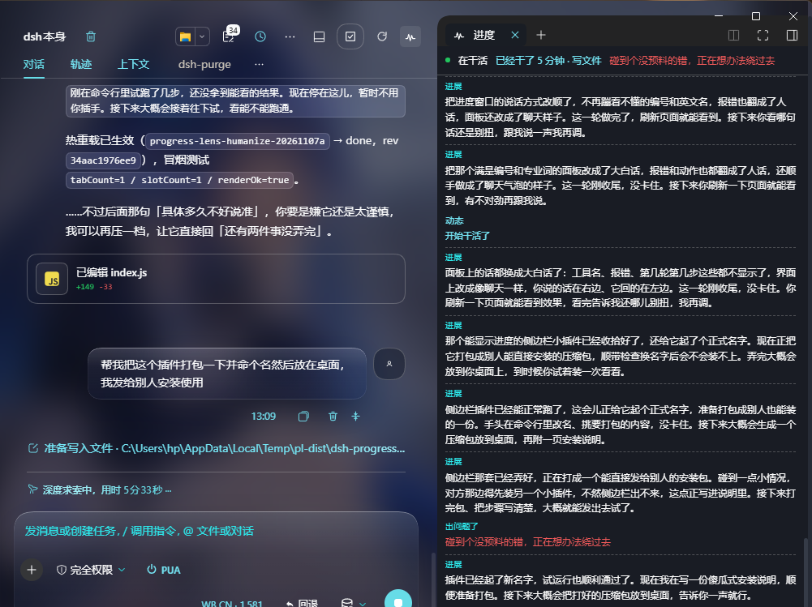
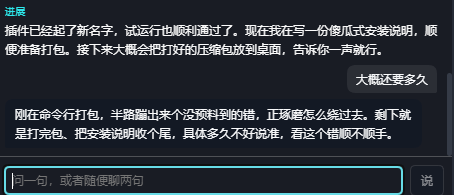

# Progress Lens · 进度透镜

**长任务跑到一半，你不知道它干到哪了。** 不想开一堆思考链翻，也不想打断它问一句。

进度透镜在右侧栏开一个小窗口。它隔一会儿用一句人话说：做完了什么、现在手头是什么、接下来大概做什么。你可以随时在里面问一句——问进度，或者随便聊两句。

跑着跑着它还会**小声嘀咕一句自己的念头**：有点犹豫、嫌麻烦、小得意、看不顺眼。不是复述思考链，是把那些不像进度、但确实是"想法"的东西，压缩成一句自言自语。

只读。不改会话，不另开模型跑任务，不打断正在跑的东西。



---

## 它解决什么

跑长任务的时候，最难忍的不是等，是**不知道在等什么**。你看见一堆工具名、文件路径、轮次步数、报错码，得自己翻译成「哦它在改那个文件」。或者干脆停下来问一句——但停下来，任务就断了。

进度透镜干三件事：

1. **翻译。** 后台收 `agent/assistant-stream`、`session/event`、`agent/status` 的原始动静，攒着，隔一段时间（或攒够十次工具调用、或一轮结束）才交给模型压成两三句人话推到你眼前。你看到的永远是摘要，不是刷屏。
2. **嘀咕。** 从思考流里挑出带主观味道的片段——犹豫、嫌烦、觉得别扭、有点得意——隔一会儿压成一句心里话，淡色斜体地排在进展下面。挑不出来就一句不说，不硬凑。
3. **能搭话。** 底部输入框随时问。走的是**独立的一次模型调用**——不带会话 ID、不带工具、不写会话记录，所以它答话不会污染你的主对话，也不会打断正在跑的任务。

工具名、路径、报错码全部翻成人话：`ops_bash` → 「在命令行里敲命令」，`EPERM` → 「有个文件被别的程序占着，改不动」，`FS_EDIT_NOT_FOUND` → 「要改的那段文字没对上，得重新找一遍」。



---

## 两种条目，别混

| | 进展 | 心里话 |
| --- | --- | --- |
| 长什么样 | 正常字重，前面标「进展」 | 淡色、斜体、左边一道浅线，不标标签 |
| 说什么 | 做完什么、卡在哪、接下来做什么 | 一句带情绪的碎碎念 |
| 多久一次 | 75 秒 / 十次工具调用 / 每轮结束 | 攒到才算，最短间隔 60 秒 |
| 谁写的 | 第三人称解说 | 第一人称，像自己小声说 |

心里话是**改写过的**，不是思考链原文。九成思考链是枯燥的执行推理，原样搬上去就是把日志刷上墙——所以先按关键词过一遍筛掉纯执行的，再让模型压成一句。模型觉得这段没什么可嘀咕的，就回一个「无」，那就真的不冒。

---

## 装

前提两件事：

- DeepSeek Harness 桌面版，`0.2.x`
- 装了 [`dsh-better-sidebar`](https://github.com/...)（进度透镜借它的右栏）

**在 dsh 里说一句就行：**

> 装一下 dsh-progress-lens，从 github:ralcer-he/dsh-progress-lens

或者直接在 **插件市场** 里搜 `进度透镜`。装完重启一次 dsh。

命令行：

```sh
dsh plugin --profile desktop add github:ralcer-he/dsh-progress-lens
```

---

## 用

会话标题栏右上角多一个脉冲折线图标。点一下，右侧栏展开——**主界面被挤窄**，不是浮在上面盖住。再点一下收起。悬停有底色，展开时底色常亮，一眼看得出开没开。

面板里长这样：

> **进展**
> 已经把右边栏从浮层改成了正经的侧边栏，现在点一下就能开合。正在核对图标的悬停底色跟旁边那些是不是一致，还没报错。接下来大概会跑一遍冒烟，再让你刷新看看。
>
> *等就等呗，反正也不差这一下……可这股劲儿憋着，怪别扭的，我是不是想多了。*

底部可以问：

- `现在到哪了`
- `大概还要多久`
- `累不累啊`
- `你是谁`

它会答：「这会儿在命令行里核对刚才跑出来的结果，暂时没卡住。剩下就是看结果对不对、再定下一步，具体多久不好说准。」

**只在当前对话窗口里出现**，切换会话就换内容，不会串。

---

## 配置

没有配置项。装上就用。

觉得吵就把它收起来，收起来它就不推了（还在后台记，展开时补齐）。

两个节奏是写死的：

- 进展：`SUMMARY_INTERVAL_MS = 75_000`、`TOOL_BURST = 10`
- 心里话：`MURMUR_INTERVAL_MS = 60_000`，单条上限 70 字

想改就改 `index.js` 顶部那几个常量，改完 `touch` 一下让它热重载。

---

## 它不做什么

- **不写你的会话。** 一个字节都不写。
- **不跑任务。** 你问它话走的是旁路调用，不带工具，改不了任何文件。
- **不猜。** 只报已经发生的。问「还要多久」，它不会编一个数字。
- **不搬原文。** 心里话是模型改写的一句，不是思考链切片。
- **不常驻。** 面板收起时不占资源，图标还在。

---

## 出问题

| 现象 | 怎么办 |
| --- | --- |
| 图标没出现 | 重启 dsh；确认插件在「插件 → 已安装」里是启用状态 |
| 图标有，点开没反应 | 没装 `dsh-better-sidebar`，先装它 |
| 面板一直「暂时还没动静」 | 当前没有任务在跑，发一个试试 |
| 一直「断线了，正在重连…」 | 宿主版本不对，需要 `0.2.x` |
| 只有进展没有心里话 | 正常。挑不出够格的念头就不冒，不是坏了 |

---

## 开发

```sh
node _smoke.mjs        # 前端半截：假 ctx + 假 React，断言 tab 与图标注册、渲染、点击开合
node _smoke_host.mjs   # 宿主半截：假 ctx + 假 SSE，断言心里话的挑料/间隔/弃权四条
```

两个半边：

- `index.js` — 宿主。订阅事件、按 `sessionId` 分桶、攒痕迹、调 `ctx.llm.stream` 压摘要和心里话、开两个 HTTP 路由（`/__progress_lens/stream` SSE、`/__progress_lens/ask` POST）。
- `client.js` — 浏览器。`ctx.betterSidebar.registerTab` 注册右栏 tab，`conversation.session.header.utilities` 注册标题栏图标。

改完这两个文件，`touch` 一下再在 dsh 里点刷新按钮就行，不用重启。改 `package.json` 的 `dsh.client.inject` 才要重启。

MIT.
